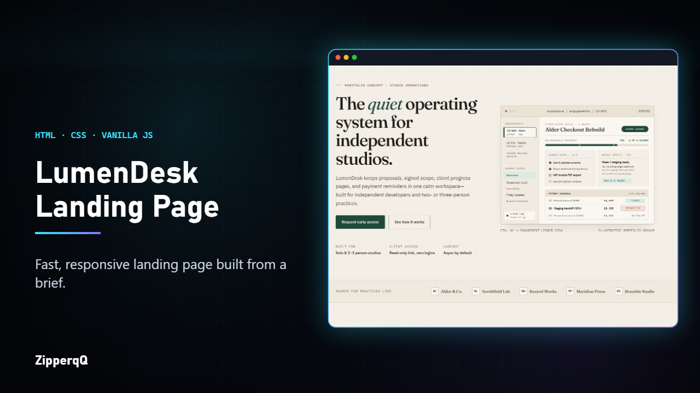
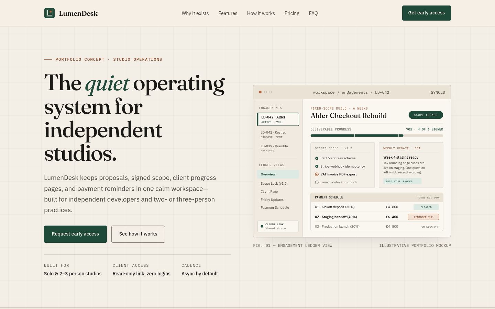
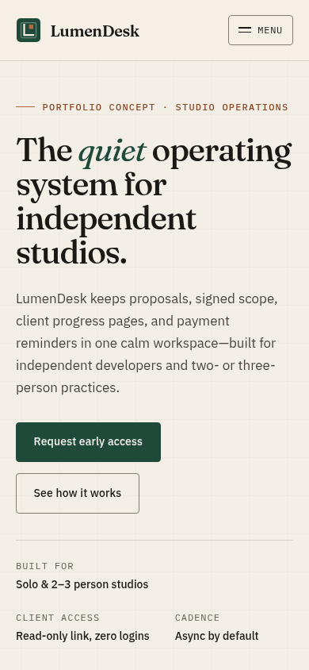

# LumenDesk — Portfolio Landing Page



**LumenDesk** (*"The quiet operating system for independent studios"*) is a fictional SaaS product landing page built as a static front-end portfolio showcase. It demonstrates editorial web design, bespoke inline SVG product illustrations, accessible interaction patterns, and clean vanilla HTML/CSS/JS engineering with no build step.

> **Portfolio Notice:** LumenDesk, its client studios, quotes, and pricing tiers are fictional. The contact form validates locally and targets a placeholder `POST /api/contact` endpoint.

---

## Key Features & Design Highlights

- **Editorial print-manual aesthetic:** Warm ivory paper ground (`#F4EFE6`), deep charcoal ink (`#1A1916`), oxidized copper accents (`#B5673E` / WCAG AA `#8E4A27`), and deep pine green primary actions (`#1F4A3A`).
- **Distinctive typography:** `Fraunces` (optical-size editorial serif) paired with `IBM Plex Sans` for UI/body copy and `IBM Plex Mono` for ledger indices, dates, and pricing metadata via Google Fonts with `preconnect`.
- **Asymmetric layout & bespoke SVG visuals:** Hand-authored inline SVG schematics for the Hero engagement workspace and all four features (Proposals & Scope Lock, Client Progress Page, Quiet Status Updates, and Payment Reminders)—no stock photography, third-party icon fonts, or generic card walls.
- **Accessible by default:** Semantic landmarks (`header`, `nav`, `main`, `section`, `footer`), single `<h1>`, skip link, WCAG 2.1 AA contrast targets for text, badges, and form control boundaries, visible `:focus-visible` states, accessible scrollable mobile drawer, WAI-ARIA keyboard FAQ accordion (`ArrowUp`, `ArrowDown`, `Home`, `End`), and `prefers-reduced-motion` support.
- **Honest contact form integration:** Explicit `method="post" action="/api/contact"` with the submit button disabled until JavaScript binds validation (preventing accidental `GET` query-string leaks). Validates Name (including short/single-character names), stricter Email syntax, optional Studio/Company, and Message ≥ 20 chars with inline field errors and `aria-live="polite"` status announcements. Submits JSON to `POST /api/contact` with duplicate-submit protection, a 10-second timeout, strict JSON delivery confirmation, and distinguishable feedback for static-demo `404`/`405`, `429`, `5xx`, redirects, timeouts, and network failures.
- **SEO & zero-tracking defaults:** Full meta tags, Open Graph, Twitter Card, JSON-LD (`Organization` + `SoftwareApplication`), `robots.txt`, and an opt-in `window.__ANALYTICS__` placeholder that loads zero external scripts by default.

---

## Screenshots

| Desktop (`1440 × 900`) | Mobile (`390 × 844`) |
| --- | --- |
|  |  |

---

## Project Structure

```text
.
├── index.html          # Semantic single-page markup, SEO, JSON-LD, inline SVG diagrams
├── css/
│   ├── tokens.css      # Color palette, typography, spacing, and motion custom properties
│   └── styles.css      # Editorial layout, components, responsive breakpoints, reduced-motion
├── js/
│   └── main.js         # Header scroll state, mobile nav, FAQ accordion, form validation, opt-in analytics
├── assets/
│   ├── favicon.svg     # Geometric brand favicon
│   ├── logo.svg        # Full wordmark + mark SVG
│   └── og-cover.svg    # 1200×630 Open Graph cover graphic
├── robots.txt          # Search crawler directive
├── docs/screenshots/   # Desktop and mobile screenshots
├── LICENSE             # MIT
└── README.md
```

---

## Local Preview

Because the site is pure static HTML, CSS, and JavaScript, you can preview it with any lightweight local web server (no install or build step required).

Using Python 3:

```bash
python -m http.server 8000
```

Or using Node.js (`npx`):

```bash
npx serve .
```

Then open `http://localhost:8000` (or the port printed by `serve`) in your browser.

> **Note:** Previewing over `http://localhost` (rather than `file://`) ensures anchor scrolling, relative assets, and the contact form's `fetch('/api/contact')` behavior mirror a real static host.

---

## Deploying to GitHub Pages

1. Push the repository contents (`index.html`, `css/`, `js/`, `assets/`, `robots.txt`, `README.md`) to a GitHub repository (for example, `lumendesk`).
2. In your GitHub repository, open **Settings → Pages**.
3. Under **Build and deployment → Source**, select **Deploy from a branch**.
4. Choose your default branch (e.g., `main`) and the `/ (root)` folder, then click **Save**.
5. After deployment completes, your site will be live at:
   `https://<your-username>.github.io/<repo-name>/`

### Project Site Path Notes

- All local stylesheets, scripts, and SVG assets use **relative paths** (`./css/styles.css`, `./js/main.js`, `./assets/favicon.svg`), so the site works cleanly on both root domains and GitHub Pages project subpaths (`/repo-name/`).
- The only root-relative path in the project is the contact form endpoint (`POST /api/contact`) inside `js/main.js`. Because GitHub Pages serves static files only, submitting the form on GitHub Pages will receive a `404`/`405` and display the built-in honest static-demo notice until you point `CONTACT_ENDPOINT` at a real backend.

---

## Customization Guide

### 1. Canonical URL, Open Graph & Social Cover Image

In `index.html`, replace every occurrence of `https://your-username.github.io/lumendesk/` in:

- `<link rel="canonical">`
- `og:url`, `og:image`, and `twitter:image`
- JSON-LD `Organization` and `SoftwareApplication` blocks

**Open Graph SVG note:** `assets/og-cover.svg` is a crisp `1200 × 630` vector cover, but many social crawlers (X/Twitter, LinkedIn, Slack, iMessage) do not render SVG Open Graph images reliably. Before sharing publicly, export `assets/og-cover.svg` to a `1200 × 630` PNG (`assets/og-cover.png`) and update `og:image` and `twitter:image` to point to the PNG URL.

### 2. Product Name & Copy

Update the brand name (`LumenDesk`), tagline, studio names, and copy directly in `index.html` and `assets/logo.svg`.

### 3. Color Palette & Typography

All visual tokens live in `css/tokens.css`:

- Ground & surfaces: `--color-paper`, `--color-paper-elevated`, `--color-paper-tint`
- Ink hierarchy: `--color-ink`, `--color-ink-secondary`, `--color-ink-muted`
- Brand accents: `--color-copper`, `--color-copper-text`, `--color-pine`
- Font families: `--font-display`, `--font-sans`, `--font-mono`

---

## Connecting the Contact Form (`POST /api/contact`)

Open `js/main.js` and locate `CONTACT_ENDPOINT` at the top of the file:

```js
const CONTACT_ENDPOINT = '/api/contact';
```

When the form passes client-side validation, it sends:

- **Method:** `POST`
- **Headers:** `Content-Type: application/json`, `Accept: application/json`
- **JSON Body:**

```json
{
  "name": "Alex Mercer",
  "email": "alex@studio.example",
  "company": "Alder & Co.",
  "message": "Three-person dev studio looking for cleaner client progress updates."
}
```

- **Direct HTTP 2xx JSON response:** Delivery is confirmed only when the endpoint returns a non-redirected `2xx` response with `Content-Type: application/json` and an explicit JSON confirmation object such as `{ "ok": true }` (also accepts `{ "received": true }` or `{ "status": "ok" | "accepted" }`). On confirmation, the button locks to prevent duplicate submissions.
- **Non-JSON `2xx`, redirects, `4xx`/`429`/`5xx`, timeout, or network error:** Preserves user input, re-enables submission, and displays a clear, distinguishable status message (never faking delivery—even if a static host returns a `200 text/html` fallback page or redirects).

Mount a serverless function (Cloudflare Worker, Netlify Function, Vercel API Route) or reverse-proxied backend route at `/api/contact` (or update `CONTACT_ENDPOINT` to your API URL with appropriate CORS headers).

---

## Enabling the Analytics Placeholder

Analytics scripts are **disabled by default**—no external tracking requests are made on page load.

To enable Google Analytics 4 and/or Plausible before launch, edit the `window.__ANALYTICS__` block in `index.html`:

```html
<script>
  window.__ANALYTICS__ = {
    ga4: 'G-XXXXXXXXXX',
    plausibleDomain: 'your-domain.example'
  };
</script>
```

`js/main.js` inspects `window.__ANALYTICS__` on `DOMContentLoaded` and injects the corresponding `<script>` tag only when an ID or domain is non-empty.

---

## Tech Stack

- **HTML5** — Semantic markup, inline SVGs, JSON-LD structured data
- **CSS3** — Custom properties, CSS Grid & Flexbox, fluid `clamp()` typography, `prefers-reduced-motion`
- **Vanilla JavaScript (ES6+)** — Zero frameworks, zero bundlers, zero build step

---

## Tests

This is a static page with no automated test suite. After starting a local server, check the hero, section scroll, FAQ accordion, mobile menu at a 390 px width, and the contact form's inline validation. On a static host the form POST cannot succeed; the page should show its honest error status instead of pretending the message was delivered.

## License

[MIT](LICENSE)
